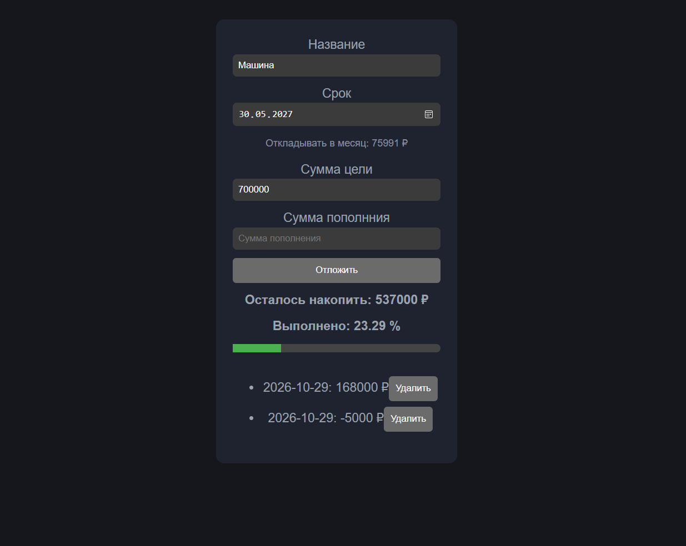

# Budget-goals

Это приложение предназначено для планирования своего бюджета к цели, которую вы поставили перед собой.

## Команды для запуска приложения
```bash
npm install     #ставим зависимости
npx vitest      #запускаем тесты
npm run dev     #запускаем сервер разработки
npm run build   #сборка
``` 

## Возможности

 - Цель и срок
 - Расчёт суммы в месяц
 - Пополнение и удаление
 - Прогресс
 - Сохранение в браузере

## Логика
Сумма в месяц = остаток / число месяцев до срока(округляется вверх).

## Тесты
Расчёты покрыты тестами (Vitest)

## Стек
- TypeScript
- React
- Vitest
- Vite

## Интерфейс приложения
